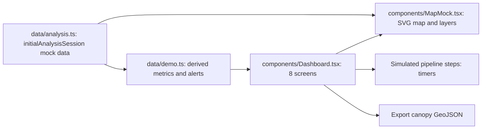

# SylvaSense

A UI-first prototype of a forest intelligence platform: it shows how Sentinel-2 optical and Sentinel-1 radar data could be fused to count trees, estimate biomass and carbon, and raise deforestation alerts for a forest reserve.

> **Everything shown is mock data.** There is no satellite data processing, no machine-learning model and no backend in this repository. The interface and the data model are real; the numbers are a curated demonstration dataset.

**Links:** [GitHub](https://github.com/shriram-s7/SylvaSense)

## Overview

Forest managers need to know how many trees a reserve has, how much carbon it stores, and where canopy is being lost. SylvaSense (Round 1 prototype for problem statement ORION-PS-03) explores what that workflow could look like in a single dashboard, using a predefined analysis session for a sample site, "Silent Valley Forest Reserve" in the Western Ghats, Kerala (384.6 ha). It demonstrates the screens, the analysis pipeline narrative and the export flow so the real engine can later be plugged in behind them.

## Features

The dashboard has eight screens (`components/Dashboard.tsx`):

| Screen | What it shows |
|---|---|
| Mission Control | Overview of the analysis session, headline forest metrics and a simulated pipeline run |
| Explorer | Map of the site with switchable layers and opacity |
| Fusion | Optical (multispectral) vs SAR (radar) complementarity |
| Canopy | Crown segmentation and tree enumeration, per-tree details, confidence filter, **GeoJSON export** of canopy crowns |
| Biomass | Above-ground biomass, carbon stock and CO2e accounting with a trajectory chart |
| Change | What changed between 2024 and 2026, with hotspots |
| Alerts | Forest-integrity alerts with optical and SAR evidence and an incident report view |
| Validation | Validation metrics and data provenance (labelled as a prototype / curated demonstration dataset) |

The GeoJSON export is generated in the browser from the mock session (`generateCanopyGeoJson`).

## How it works



A single typed `AnalysisSession` object (target, dates, sensors, canopy, biomass, change hotspots, validation) drives every screen. The "pipeline run" is a timer-based animation and the map is a hand-built SVG mock, not a real map or raster engine.

## Tech stack

| Layer | Technology |
|---|---|
| Framework | Next.js 15 (App Router), React 19, TypeScript |
| Charts | Recharts |
| Icons | lucide-react |
| Styling | plain CSS (`app/globals.css`) |
| Data | static TypeScript modules (no API, no database) |

## Project structure

```text
app/           Next.js entry (layout, page, global styles)
components/    Dashboard.tsx (all screens), MapMock.tsx (SVG map mock)
data/          analysis.ts (typed mock analysis session, GeoJSON generator), demo.ts (derived values)
```

## Getting started

Prerequisites: Node.js 20 or newer and npm. No environment variables or secrets are needed.

**Windows (PowerShell) and Linux / macOS**

```bash
npm install
npm run dev
```

Open http://localhost:3000. For a production build run `npm run build` and `npm start`.

Note: `package.json` lists `@next/swc-win32-x64-msvc` as a dependency; on Linux or macOS npm may warn that it does not apply to your platform, but installation should still work (not tested on those systems).

## Usage

1. Start on **Mission Control** and run the simulated pipeline.
2. Switch map layers in **Explorer**, then open **Canopy**, pick a tree and use **Export Canopy GeoJSON**.
3. Review **Change** and **Alerts** for the two hotspot stories, and **Validation** for the stated provenance.

## Tests

There is no test suite. Observed while writing this README: `npm ci` and `npm run build` succeeded (Next.js static build, one route). The app was not opened in a browser, and `npm run lint` was not run.

## Status and limitations

- Round 1 prototype: UI and data model only. Sentinel-1/2 ingestion, fusion, canopy segmentation, biomass models, change detection and validation are **simulated with fixed data**.
- The map is an SVG illustration; there are no real rasters.
- Planned next step (from the original notes): replace `MapMock.tsx` with Mapbox GL JS or Deck.gl, add prepared raster/GeoJSON assets, split the dashboard into route-level screens and connect a mock FastAPI service.

## License

No license specified.
